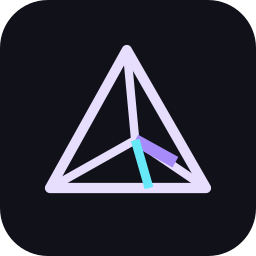

<p></p>

# Prism

**See every branch. Understand every change.**

Prism brings visual branch planning, integration analysis, conflict visibility, and pull request creation into VS Code. Visualize your branch strategy, inspect integration evidence, and prepare changes with confidence. **Branch Flow works without AI, a backend, or a paid service.** Optional Anthropic, Gemini and OpenAI assistance remains available in the existing PR Creator.

Prism’s extension identifier is **`axvrma.prism`**. Its `azureDevopsPr.*` setting names, command IDs, and `.branchflow.json` file format stay compatible.

If you installed an earlier build under the previous extension identity, disable or uninstall that copy before enabling Prism to avoid duplicate command registrations. VS Code scopes credentials and history by extension ID, so re-enter your Azure PAT and optional AI provider keys, then reopen saved graph files. Extension-scoped credentials, PR history, and recent-file history do not transfer automatically; your graph files remain on disk.

[Source code](https://github.com/axvrma/prism) · [Report an issue](https://github.com/axvrma/prism/issues)

## Branch Flow

Run **Prism: Open Branch Flow**, or use **New graph** in the sidebar’s collapsible **Branch Flow** section. That section also lists recently opened graphs; **Pull Requests** has its own collapsible section. New graphs reuse the PR Creator’s selected project and repository. Change the context at any time using the repository control in the graph toolbar. If no selection is available, choose an HTTPS organization, project and repository using the native picker. Configure your PAT in **Prism: Open Settings** first.

The primary sidebar keeps repository and branch context above both tools, with connection status and a Settings shortcut. Branch Flow has separate **New graph** and **Open graph** actions and a compact recent-file list.

To tidy the list, open a recent graph’s **…** menu and choose **Remove from recent**. You can also use **Actions → Remove Recent…** in the graph editor. These actions update Prism’s saved recent list only: they do not delete files, change graph contents, or close an open graph. Reopening a closed file or saving the file again adds it back to Recent.

1. Search remote branches and drag them onto the canvas, or use each branch's **+** button.
2. Connect source A to target B to plan propagation **A → B**. Choose Merge / PR, Rebase target onto source, or unverified Cherry-pick. Forks, convergences and disconnected components are supported; cycles and cross-repository connections are rejected.
3. Use **Analyze All** or select a relationship and **Revalidate**. Inspect exact commit SHAs, evidence, outstanding source commits, matching active PRs, policy evaluations and conflict details. The overview suggests dependency order and downstream revalidation.
4. For a merge relationship, **Create PR…** opens the existing editable PR Creator with repository and branches prefilled. An existing active PR opens instead. Only explicit submission creates a remote PR; Branch Flow never merges, pushes or performs remote rebases.
5. Save locally as `.branchflow.json`. Saved graphs automatically revalidate on open and when revealed. Refresh manually or opt into polling. Native VS Code dirty-close warnings and backups protect unsaved work; external edits produce a protected-save warning with Reload and Save As recovery.

The toolbar’s **Actions** menu contains New, Save, Save As, Open, Recent, Import/Export JSON, Refresh, Analyze All, Auto Layout, Fit View, Undo and Redo. Connection mode, snap, repository and Settings share the same compact toolbar. First Save opens the native filename dialog; Save As always lets you choose a new name. The canvas supports multiple selection, node/edge deletion, context menus, keyboard movement, zoom/pan, snap-to-grid and a minimap. Scroll pans vertically, Shift+scroll pans horizontally, and Ctrl/Cmd+scroll or pinch zooms. New branches are placed without overlap. Action toasts confirm results; the inspector’s **Errors** section retains operation, time and details after notifications disappear. A renderer recovery panel preserves access to the editor and save actions if the canvas fails. Use **Connect branches with keyboard** in the inspector for an alternative to dragging connection handles. Delete/Backspace removes the selection; Ctrl/Cmd+Z and redo shortcuts restore graph edits. Branch search is debounced and displays 100 results per page. VS Code light/dark/high-contrast colors and text status labels are supported.

| Status | Meaning |
| --- | --- |
| SYNCED · green | Current source ancestry is positively verified in the current target |
| ACTION REQUIRED · yellow | Integration remains; the explanation states whether a merge/rebase was actually simulated |
| CONFLICT · red | Actual local simulation or exact-head Azure PR merge conflict evidence exists |
| PR ACTIVE · blue | Matching active PR; policies and completion may still block it |
| DRIFTED · orange | Saved evidence is stale because heads or dependencies changed |
| ANALYZING | Validation is in progress; Cancel stops obsolete work |
| UNKNOWN | Inconclusive evidence, missing refs or unavailable simulation |
| ERROR | An operation failed; this is not a Git conflict |

A completed or squash-merged PR does not automatically prove current source ancestry. Cherry-pick is explicitly unverified in V1. Rebase A → B means replay B-only commits onto A in a temporary repository. A clean merge is not proof of a clean rebase. Local simulation requires a matching trusted, complete clone with the exact Azure objects already present; fetch manually when necessary. The extension leaves your checkout, index, branches and dirty files alone. Without a suitable clone, cloud merge planning still works and exact rebase simulation remains UNKNOWN. See [operation semantics and file format](docs/branch-flow/semantics-and-format.md).

## PR Creator and optional AI

Run **Prism: Create Pull Request** or **Raise PR**. Select a repository and editable source/target branches, enter a title/description manually, and optionally link comma-separated work-item IDs. **AI** can suggest content using local Git commits and diff context when you configure a provider/key. Manual PR creation and all Branch Flow operations work without AI. PR history retains ten locally stored entries; the last PR URL can be copied from the command palette.

Set up provider, model, token limit and temperature in Settings. AI generation intentionally sends the chosen commit/diff context to that provider. No AI service is called by Branch Flow analysis. Provider model availability and live Azure permissions depend on your account.

## Configuration and requirements

- VS Code **1.60.0+**; Git is needed for workspace hints and optional local analysis. Git 2.38+ is recommended for simulation.
- Azure DevOps HTTPS organization URL, project and PAT. HTTPS on-premises organization/collection URLs are accepted; REST version must match the server. HTTP URLs and embedded URL credentials are refused.
- Code Read permission for analysis; Code Read/Write for explicit PR creation. Work Items Read/Write is needed only for work-item linking.
- Optional provider API key for Anthropic, Google Gemini or OpenAI.

| VS Code setting | Default / purpose |
| --- | --- |
| `azureDevopsPr.orgHost` | Organization URL configured in Settings |
| `azureDevopsPr.project` | Project configured in Settings |
| `azureDevopsPr.apiVersion` | `7.1` |
| `azureDevopsPr.branchFlow.localAnalysis` | `true`; disabled in untrusted workspaces regardless of setting |
| `azureDevopsPr.branchFlow.pollIntervalSeconds` | `0`, disabled; positive intervals have a 30-second minimum |
| `azureDevopsPr.useAI` | `true`; existing optional AI behavior |
| `azureDevopsPr.generateDescription` | `true`; optional AI description |
| `azureDevopsPr.autoAcceptAI` | `false`; existing behavior setting retained |
| `azureDevopsPr.aiProvider` / `aiModel` | Provider and model; blank model uses provider default |
| `azureDevopsPr.aiMaxTokens` / `aiTemperature` | `1024` / `0.3` |
| `azureDevopsPr.enableTelemetry` | `true`; also respects VS Code's telemetry switch |

If a graph names another organization, credentials are withheld until you explicitly select/authorize that context. A deleted/renamed branch should be replaced in the graph. A shallow/partial clone, missing objects or simulation failure cannot produce a clean rebase claim. See the in-panel recovery explanation and [verification guide](docs/branch-flow/release-verification.md).

## Security and privacy

PATs and provider keys stay in VS Code SecretStorage and the extension host. Webviews receive presence flags, never stored secrets. Branch Flow uses bundled local scripts/styles with a nonce CSP and no network connections. All filesystem, authenticated HTTP and Git operations run in the host. Graph imports and messages have runtime schemas and limits; Git uses argument arrays. API logs and errors exclude credentials and raw response bodies.

Branch Flow adds no telemetry events. Existing PostHog usage events are limited by an allowlist to aggregate counts, booleans, provider/source categories and fixed failure categories. Branch/repository/organization names, SHAs, graph/source/diff contents, credentials and unrestricted errors are dropped. A pseudonymous VS Code machine ID is used to count installations. Disable usage analytics in extension Settings or disable VS Code telemetry. Saved graphs, backups, history and Recent paths are local user data and can contain private metadata; protect them accordingly. [Security review](docs/branch-flow/security-review.md).

## Development and release

Build/test tooling uses **Node 22.12+ within the 22.x release line**, selected by the root `.nvmrc` and CI. Node 24.x and 26+ are also accepted by the extension toolchain; the standalone website targets Node 22. Extension users do not need to install Node.

From the repository root, select the runtime **before** installing dependencies or packaging:

```sh
nvm install
nvm use
node --version
npm ci
npm run vscode:package
```

If you use another Node version manager, select Node 22.12+ in the 22.x release line. The version check must show `v22.12.0` or newer in that release line. Packaging creates a local `.vsix`; it does not publish it.

An error such as `node:util does not provide an export named styleText` means an older Node runtime is loading the current build tools. Select Node 22 using the commands above, then rerun `npm ci`. The project now checks Node at install, verification, test and build entry points so unsupported versions receive these instructions before loading Vite/Vitest.

Run `npm run verify`, `npm run test:browser` (after `npx playwright install chromium`), and `npm run test:extension` for the remaining checks. The production host/browser bundles exclude development dependencies. [Release checks, budgets and manual Azure validation](docs/branch-flow/release-verification.md) · [existing-system audit](docs/architecture/existing-system.md) · [implementation checklist](docs/branch-flow/implementation-checklist.md).

MIT · Built by Abhishek Verma. Bundled libraries retain their licenses in [THIRD_PARTY_NOTICES.md](THIRD_PARTY_NOTICES.md).

## Prism marketing website

The standalone React website lives in [`apps/website`](apps/website/README.md). It has independent dependencies, tests, and Netlify configuration. Website development does not require building or packaging the extension.

## Shared Prism branding

The extension reuses the website’s geometric mark from `apps/website/public/prism-logo.svg`: the Extensions icon, monochrome Activity Bar icon, sidebar, PR Creator, Settings, and Branch Flow all use that geometry. Webview marks follow the active VS Code theme; the website’s purple and cyan accents remain restrained, and high-contrast themes use native foreground colors.

Generated files are checked in, so building the extension does not require the website’s dependencies. To regenerate the SVG, inline mark, and PNG icons after editing the website logo:

```sh
npm --prefix apps/website ci
npm run brand:sync
npm run brand:check
```

The synchronization command uses the website’s existing Sharp development dependency; it adds no runtime dependency to the extension. `npm run verify` checks that the generated vectors still match the website. The raster icon uses the same mark on the website’s dark surface; the Activity Bar variant is monochrome to follow VS Code’s icon treatment.
